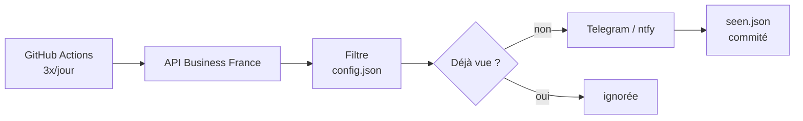

# vie-watcher

[](https://github.com/Rayane-94/Scraping_VIE/actions/workflows/ci.yml)


Bot open source qui surveille les offres VIE de [mon-vie-via.businessfrance.fr](https://mon-vie-via.businessfrance.fr) et envoie sur Telegram les nouvelles offres qui correspondent à **ton** profil.

Il tourne gratuitement sur GitHub Actions, 3 fois par jour : pas de serveur, pas de PC allumé.

```
Data Analyst (H/F)
🏢 ACME
📍 MONTREAL, CANADA
⏱ 18 mois · 💶 3814 €/mois
🗓 Début de mission : 01 janvier 2027
🧩 python, sql, power bi
📢 Date de publication : 23 octobre 2026
⌛ Date d'expiration : 22 novembre 2026
https://mon-vie-via.businessfrance.fr/offres/247434
```

## Adaptable à n'importe quel métier

Ce repo est configuré pour du développement full stack, mais tout le ciblage se fait dans [`config.json`](config.json), sans toucher au code. Fork le projet, remplace les mots-clés, et le bot cherche pour toi : finance, marketing, ingénierie, commerce…

```json
{
  "include": ["data (analyst|scientist|engineer)", "business intelligence", "\\bbi\\b"],
  "exclude": ["stage"],
  "countries": ["CA", "belgique"],
  "highlight": ["python", "sql", "power ?bi", "tableau", "spark"]
}
```

| Clé | Rôle |
|---|---|
| `include` | le titre doit contenir au moins un de ces mots |
| `exclude` | titres à écarter |
| `countries` | pays ciblés, `[]` pour tous |
| `highlight` | compétences à repérer dans l'offre, affichées dans le message |

Les mots-clés sont des regex, sans tenir compte des accents ni des majuscules. Telegram ne te convient pas ? Le bot peut aussi notifier via [ntfy](https://ntfy.sh).

## Installer son propre bot

1. **Fork** ce repo, puis supprime `seen.json` (c'est l'historique des offres déjà envoyées me concernant, le bot la recrée tout seul).
2. **Crée un bot Telegram** : sur [@BotFather](https://t.me/BotFather), envoie `/newbot` et note le token. Envoie un message à ton bot, puis ouvre `https://api.telegram.org/bot<TOKEN>/getUpdates` pour récupérer ton `chat.id`.
3. **Ajoute les secrets** dans *Settings › Secrets and variables › Actions* : `TELEGRAM_TOKEN` et `TELEGRAM_CHAT` (ou `NTFY_TOPIC` pour ntfy).
4. **Adapte `config.json`** à ton métier. Vérifie le résultat sans rien envoyer avec `npm run dry-run`.
5. **Lance le bot** : sur un fork, GitHub désactive les Actions par défaut. Active-les dans l'onglet *Actions*, puis *vie-watcher › Run workflow*. Il tournera ensuite tout seul (horaires réglables dans [`vie.yml`](.github/workflows/vie.yml)).

## Comment ça marche



À chaque lancement, le bot récupère toutes les offres via l'API du site, filtre selon `config.json` et envoie celles qu'il n'a pas encore vues. La mémoire du bot (`seen.json`) est commitée dans le repo après chaque passage, d'où les commits `chore: maj seen.json`.

Quelques choix techniques :
- **Pas de base de données** : l'état est versionné dans Git, ce qui suffit pour un job qui repart d'une machine vierge à chaque run.
- **Aucune offre perdue** : une offre n'est marquée comme vue qu'une fois la notification envoyée.
- **Fail-safe** : si l'API renvoie une réponse vide ou incomplète, le bot s'arrête sans rien modifier.
- **Secrets masqués** dans les logs, visibles publiquement sur un repo open source.

## Développement

TypeScript strict, exécuté nativement par Node.js 24 : aucune étape de build, aucune dépendance à l'exécution.

```bash
npm install
npm run dry-run     # lance le bot sans rien envoyer
npm run typecheck   # vérifie les types
npm test            # tests unitaires
```

```
src/
  main.ts     orchestration
  vie.ts      client de l'API Business France
  filter.ts   filtrage selon config.json
  format.ts   mise en forme du message
  notify.ts   envoi Telegram et ntfy
  seen.ts     mémoire des offres envoyées
  http.ts     fetch avec timeout et retry
```

Les contributions sont les bienvenues : issue, idée ou pull request.
